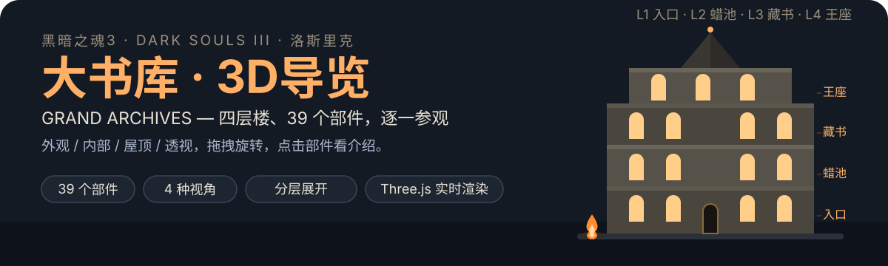
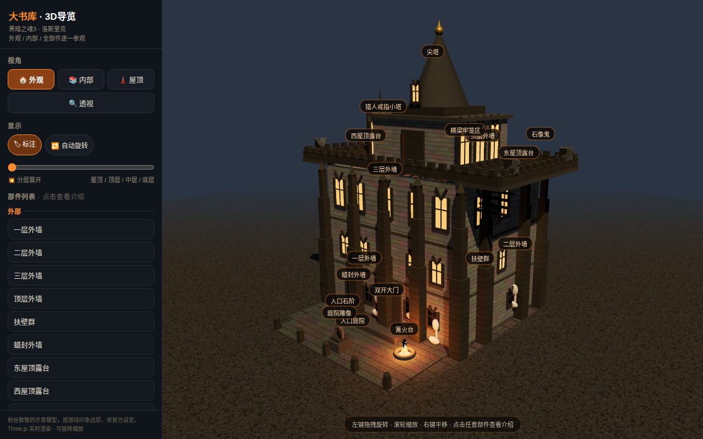
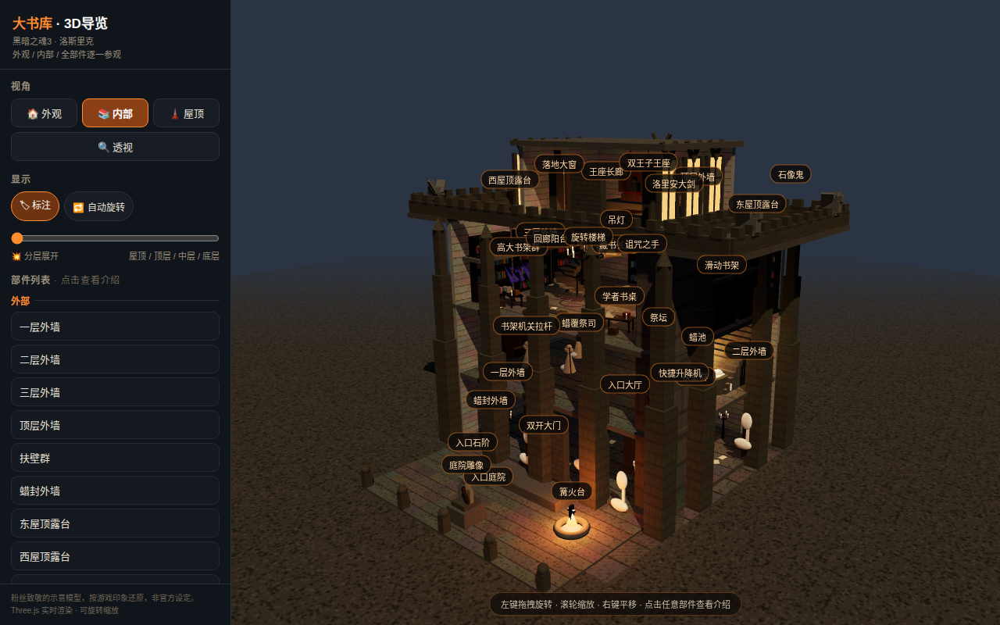

<p align="right"><a href="README.md">中文</a></p>

<p align="center">
  
</p>

<p align="center">
  <a href="https://holynova.github.io/grand-archives-ds3/">▶ Visit Online</a>
  ·
  <a href="https://github.com/holynova/grand-archives-ds3">GitHub Repository</a>
</p>

An interactive 3D tour of the Grand Archives from Dark Souls III: a procedurally modeled Lothric library in Three.js — four floors, rooftop terraces, an octagonal spire, and 39 annotated parts, from the wax pool and curse hands to the Twin Princes' throne. Drag to orbit, scroll to zoom, click any part for its story. Zero build, just open it.

## Screenshots

<p align="center">
  
</p>
<p align="center">
  
</p>

## How to Explore

- **4 views**: exterior, interior, roof, and X-ray — X-ray mode sees through walls to the inner structure.
- **Exploded layers**: a slider pulls the roof / top / middle / bottom floors apart to show how they stack.
- **39 parts**: the sidebar lists parts grouped by floor; click one to jump the camera and open its story — or click the part directly on the 3D model.
- **Labels & auto-rotate**: toggle floating labels with one click; auto-rotate works as a screensaver-style browse.

## The Four Floors

| Floor | Name | Highlights |
|------|------|------|
| L1 | Entrance Hall | Double doors, Crystal Sage, entrance courtyard and bonfire |
| L2 | Wax Pool Hall | Wax pool ("dip your head in wax"), altar, wax-covered priests, bookshelf mechanism lever, shortcut lift |
| L3 | Book Gallery | Book gallery, tall bookshelf clusters, curse hands, gallery balcony, spiral stairs |
| L4 | Throne Room | Twin Princes' throne, Lorian's Greatsword, tall windows, red carpet |
| Roof | Rooftops | East and west terraces, gargoyles, Hunter's Ring tower, beam cage area, octagonal spire |

The floor layout is distilled from public wiki floor maps and walkthrough descriptions (see `REFERENCE.md`); it is an indicative fan tribute, not a 1:1 recreation, and the central ring staircase is an artistic addition.

## Run Locally

Zero build, but ES modules need HTTP (double-clicking `index.html` will be blocked by the browser):

```bash
python3 -m http.server 8000
# Open http://localhost:8000
```

## Tech

- Three.js 0.160 + OrbitControls, real-time rendering, soft shadows, ACES tone mapping.
- Fully procedural modeling and textures: stone walls, wood grain, book pages, wax, and carpet are all Canvas-generated, with no external textures.
- Data-driven parts (the `PARTS` table in `app.js`: name, category, floor, label position, description).
- Mobile-friendly: the sidebar collapses on narrow screens, and portrait fov widens so the whole building fits.

```
index.html      Entry (sidebar: views / display / parts list; Three.js importmap)
app.js          All logic: scene, procedural textures, modeling, 39 part definitions, interaction
REFERENCE.md    Reference notes: real floor structure summary and discrepancies with the old version
```

A fan tribute; Dark Souls III © FromSoftware / Bandai Namco.
