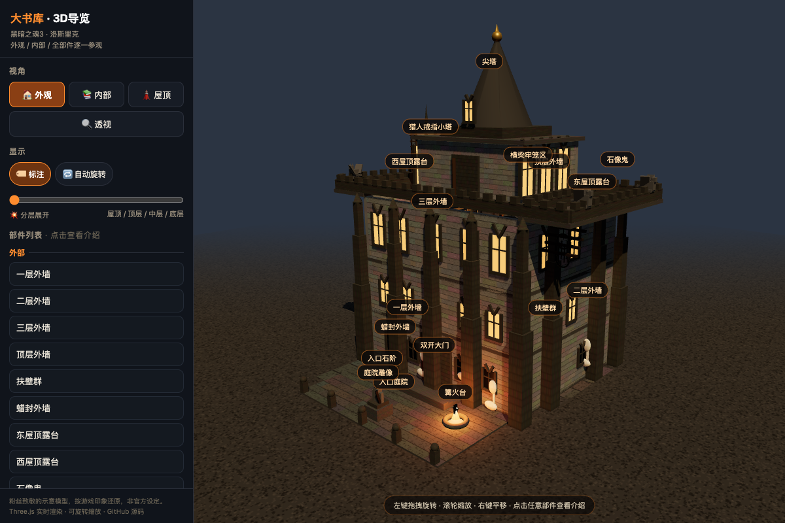

# Grand Archives DS3 3D / 大书库 · 黑魂3 3D导览

中文：基于 Three.js 制作的《黑暗之魂3》大书库 3D 立体空间导览。精细还原多层书架建筑、屋顶穹顶、蜡油池与隐蔽通道，支持外观、内部、屋顶与透视多视角切换、分层展开、自动旋转与空间部件点击导览。

English: Interactive 3D walk-through of Grand Archives from Dark Souls 3 built with Three.js. Recreates multi-story bookshelves, rooftop domes, wax pools, and secret paths with multi-angle viewpoints, exploded layer views, and interactive landmark annotations.



## 在线体验 / Live Demo

- [Cloudflare Demo](https://xiaosang.cc/grand-archives-ds3/)
- [GitHub Repo](https://github.com/holynova/grand-archives-ds3)


## 本地运行 / Run locally

```bash
python3 -m http.server 8000
```

## 发布 / Deploy

```bash
npx wrangler deploy --config wrangler.jsonc
```

Cloudflare Workers · Domain: `xiaosang.cc` · Route: `/grand-archives-ds3/`

源码与部署配置使用同一个主分支（main）；在本地手动发布，不创建 Cloudflare 专用分支或 GitHub Action。
