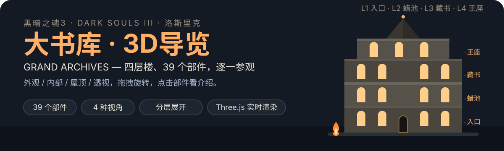
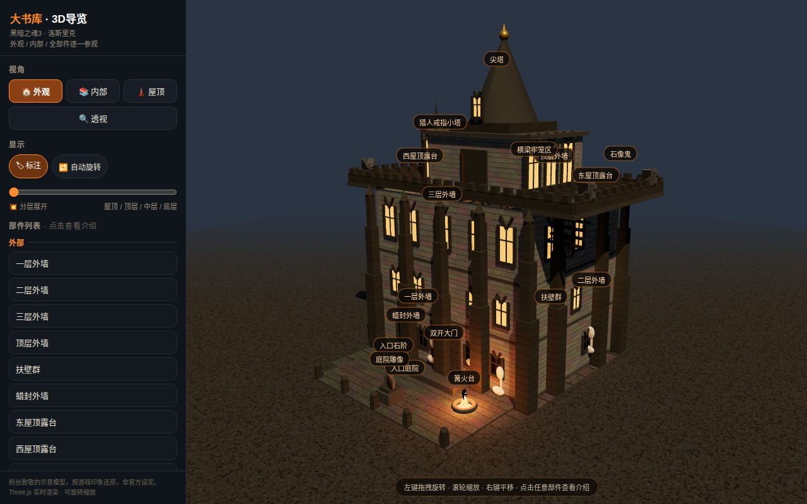
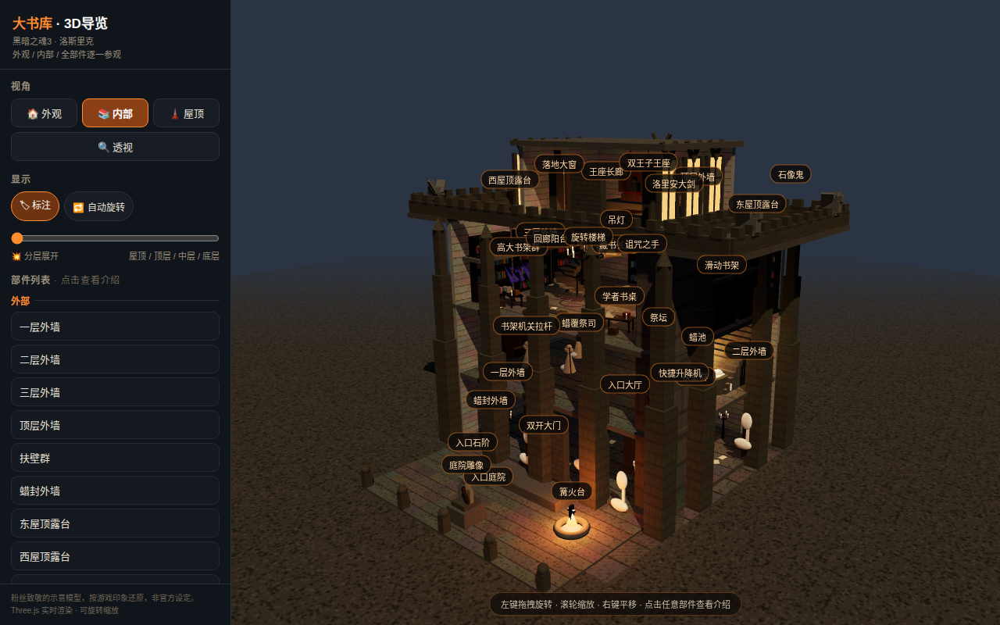

<p align="center">
  
</p>

<p align="center">
  <a href="https://holynova.github.io/grand-archives-ds3/">▶ 在线参观 Visit Online</a>
  ·
  <a href="https://github.com/holynova/grand-archives-ds3">GitHub 仓库</a>
</p>

黑暗之魂3「大书库」的 3D 互动导览：用 Three.js 程序化建模还原洛斯里克的大书库——四层楼体、屋顶露台、八角尖塔，39 个部件各有介绍。拖拽旋转、滚轮缩放，点任意部件看它的故事：蜡池、诅咒之手、双王子王座都在。零构建，打开即看。

An interactive 3D tour of the Grand Archives from Dark Souls III: a procedurally modeled Lothric library in Three.js — four floors, rooftop terraces, an octagonal spire, and 39 annotated parts, from the wax pool and curse hands to the Twin Princes' throne. Drag to orbit, scroll to zoom, click any part for its story. Zero build, just open it.

## 截图 / Screenshots

<p align="center">
  
</p>
<p align="center">
  
</p>

## 怎么看 / How to Explore

- **4 种视角**：外观、内部、屋顶、透视——透视模式穿墙看内部结构。
- **分层展开**：滑杆把屋顶 / 顶层 / 中层 / 底层逐层拉开，看清楼层叠放。
- **39 个部件**：左侧部件列表按楼层分组，点击即跳转视角并弹出介绍；也可以直接点 3D 模型上的部件。
- **标注与自动旋转**：一键开关浮动标注；自动旋转适合当屏保式浏览。

## 四层楼 / The Four Floors

| 楼层 | 名字 | 看点 |
|------|------|------|
| L1 | 入口大厅 | 双开大门、结晶老者、入口庭院与篝火 |
| L2 | 蜡池厅 | 蜡池（"把头浸入蜡中"）、祭坛、蜡覆祭司、书架机关拉杆、快捷升降机 |
| L3 | 藏书回廊 | 藏书长廊、高大书架群、诅咒之手、回廊阳台、旋转楼梯 |
| L4 | 王座厅 | 双王子王座、洛里安大剑、落地大窗、红毯 |
| 屋顶 | 屋顶区 | 东西露台、石像鬼、猎人戒指小塔、横梁牢笼区、八角尖塔 |

楼层结构参考公开 wiki 的楼层地图与流程描述归纳（见 `REFERENCE.md`），属粉丝致敬的示意还原，非 1:1 复刻；中央环形大楼梯为艺术加工。

## 本地运行 / Run Locally

零构建，但 ES module 需要走 HTTP（直接双击 `index.html` 会被浏览器拦截）：

```bash
python3 -m http.server 8000
# 打开 http://localhost:8000
```

## 技术 / Tech

- Three.js 0.160 + OrbitControls，实时渲染、软阴影、ACES 色调映射。
- 全部程序化建模与纹理：石墙、木纹、书页、蜡、地毯均由 Canvas 程序生成，无外部贴图。
- 部件数据驱动（`app.js` 的 `PARTS` 表：名字、分类、楼层、标注位置、介绍文案）。
- 移动端适配：窄屏下侧栏收起，竖屏 fov 放大让建筑完整入镜。

```
index.html      入口（侧栏：视角 / 显示 / 部件列表；Three.js importmap）
app.js          全部逻辑：场景、程序化纹理、建模、39 个部件定义、交互
REFERENCE.md    还原参考：真实楼层结构归纳与旧版不符点清单
```

## English

**Grand Archives 3D Tour** is an interactive Three.js walkthrough of the Grand Archives from Dark Souls III — a procedurally built model of the Lothric library with four floors, rooftop terraces, and an octagonal spire.

- **39 annotated parts**: every wall, wax pool, bookshelf mechanism, curse hand, and throne has a name and a short story. Click a part in the sidebar or directly on the model.
- **4 views**: exterior, interior, roof, and X-ray. An "explode" slider separates the floors to show how they stack.
- **Floors**: L1 entrance hall, L2 wax pool hall, L3 gallery of shelves, L4 Twin Princes' throne room, plus rooftops with gargoyles and the Hunter's Ring tower.
- **Run it**: `python3 -m http.server 8000`, then open http://localhost:8000 (ES modules need HTTP, not `file://`).
- **Tech**: Three.js 0.160, fully procedural geometry and Canvas-generated textures — no external assets.

## 许可 / License

粉丝致敬作品，未附开源许可；《黑暗之魂3》版权归 FromSoftware / 万代南梦宫所有。Fan tribute, no open-source license attached; Dark Souls III © FromSoftware / Bandai Namco.
